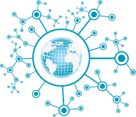
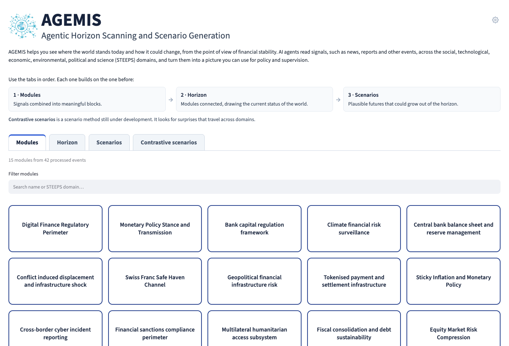
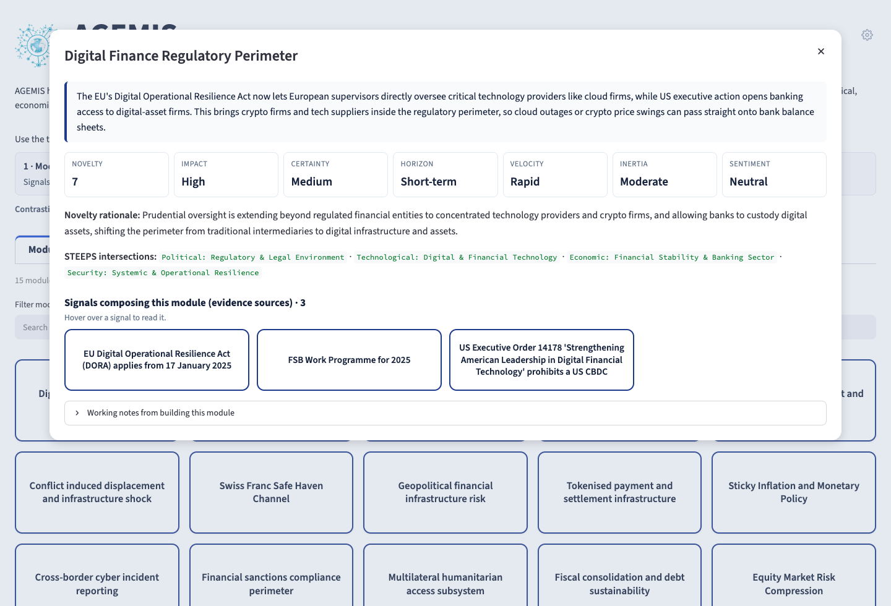
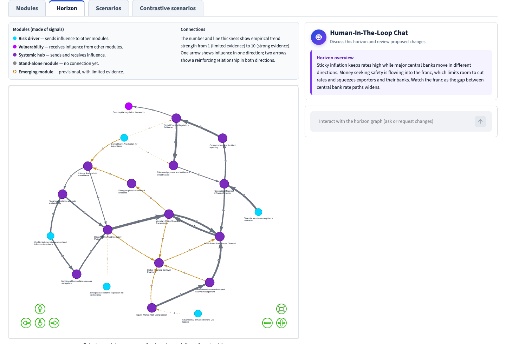
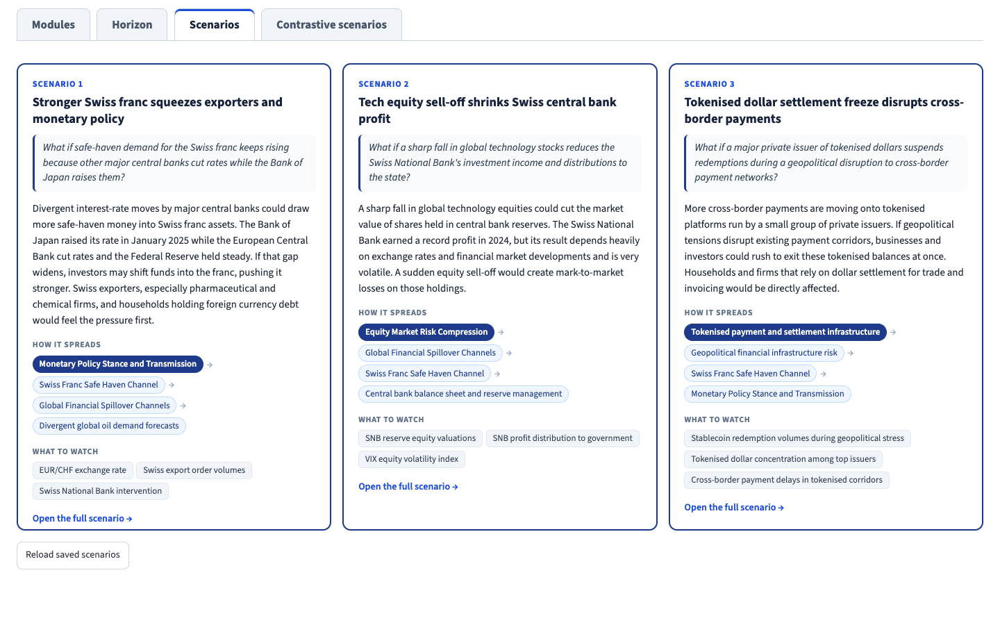
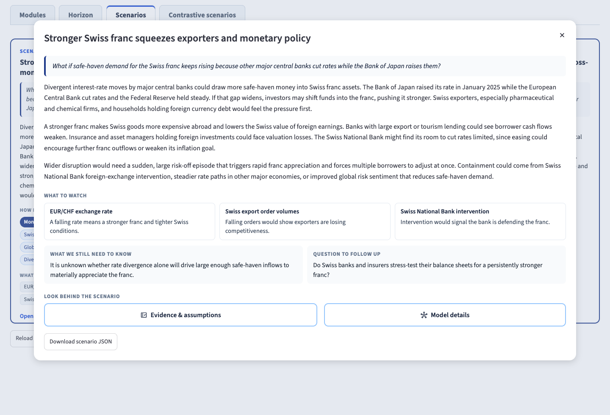

<p align="center">
  
</p>

<h1 align="center">AGEMIS</h1>
<p align="center"><br>Agentic generation and evaluation of modular integrated scenarios</p>

This AGEMIS platform was developed during a two-semester research project within the **AFE programme**
(Applied Research and Development, or Scientific Assignment Group Project) at the Bern University of Applied Sciences.

**Project supervision:** Prof. Dr. Lucia Gomez Teijeiro

**Student contributors:** Lina Sophie Schwonnek, Kay Jana Sheppard, Mathias Daniel Barmet, and David Seppi. 
The students contributed in equal proportion across the project, with responsibilities distributed.

> [!NOTE]
> **Published in the *Journal of Digital Banking*.** The design-thinking exercise behind this platform is described in:
>
> Gomez Teijeiro, L., Hadji Misheva, B. and Maillart, T. (2026). *Unlocking the future: Artificial intelligence–powered horizon scanning for financial stability*. **Journal of Digital Banking**, 11(2), 160–173. DOI: [10.69554/SFYB4739](https://doi.org/10.69554/SFYB4739)
>
> 📖 [Journal page at Henry Stewart Publications (Volume 11, 2026–27)](https://henrystewartpublications.com/journal/journal-of-digital-banking/volume-11-2026-27/) · 📄 [Paper, abstract and DOI on Ingenta Connect](https://www.ingentaconnect.com/contentone/hsp/jdb001/2026/00000011/00000002/art00006)

---

## What is AGEMIS?

Central banks and financial supervisors have to make decisions under constant uncertainty: geopolitical
tensions, technological shifts, climate change and market shocks interact in ways that standard stress
tests and periodic scenario exercises struggle to capture. **Horizon scanning** looks for early, weak
signals of change, but in practice it is often manual, episodic and hard to trace.

AGEMIS turns horizon scanning into a continuous, traceable and computational process. AI agents read
signals (news, reports, regulatory texts and other events) across the **social, technological, economic,
environmental, political and science (STEEPS)** domains and build three things that supervisors and policy
makers can use:

| Step | Tab in the app | What you get |
| --- | --- | --- |
| **1 · Modules** | *Modules* | Signals combined into meaningful blocks, such as a rising risk or a growing dependence. Each module has a plain-language summary, ratings (novelty, impact, certainty, horizon, velocity, inertia, sentiment) and the signals it is built from. |
| **2 · Horizon** | *Horizon* | The modules connected into a graph: the current status of the world, showing what drives what. A short overview summarises it, and a human-in-the-loop chat lets experts question and adjust the graph. |
| **3 · Scenarios** | *Scenarios* | Plausible futures that could grow out of the horizon, each with a "what if" question, a short narrative, what to watch, what we still need to know, and the evidence and model mechanics behind it. |

A fourth tab, **Contrastive scenarios**, is a scenario-generation method still under development. It looks
for surprises that travel far across domains rather than starting from the most fragile point.

AGEMIS is a **companion, not a decision maker**: experts stay in the loop at every stage, and every output
can be traced back to the signals and assumptions it rests on.

## Screenshots

**Overview and modules.** The platform explains itself on the first screen; each square is a module.



**A module.** A plain-language summary, the ratings in one row and the signals that compose the module (hover over a signal to read it).



**Horizon.** The horizon graph, a short overview of the current state of the world, and the human-in-the-loop chat.



**Scenarios.** Each card previews a plausible future: the "what if" question, how it starts, how it spreads and what to watch.



**A scenario.** The full story first, with the evidence, assumptions and model details one click away.



## How it works

AGEMIS follows the four agentic phases described in the paper:

- **A · Domain decomposition** (`phase_a/`): extracts structural implications from each signal, clusters them and synthesises **modules**, with STEEPS domains, ratings and evidence. Weak and emerging signals are kept for later.
- **B · Horizon mapping** (`phase_b/`, `phase_b_mapper.py`): connects the modules into a weighted **horizon graph** (empirical trend strength, narrative salience, institutional relevance), stored in FalkorDB.
- **C · Scenario generation** (`phase_c/`): shocks the horizon graph, follows how stress propagates, and lets a language model write each **scenario** from the evidence on that path, with checked references.
- **D · Evaluation** (`phase_d/`): scores scenarios on systemic impact, plausibility and policy coverage.

The user interface (`phase_ui.py`, built with Streamlit) shows the saved results and lets experts review and
adjust them. Results are stored in `main_state.json`; this repository includes a pre-computed run so the app
can be explored without running the pipeline.

## Quick start

Requirements: Python 3.11+, Docker (for FalkorDB) and an OpenAI-compatible language-model endpoint
(for example a local [Ollama](https://ollama.com) model).

```bash
cp .env.example .env                 # set BASE_URL, API_KEY and MODEL_NAME for your endpoint
python3 -m venv .venv && ./.venv/bin/pip install -r requirements.txt
docker run -p 6379:6379 -p 3000:3000 -e REDIS_ARGS="--requirepass agemis" -it --rm falkordb/falkordb:latest
./.venv/bin/python scripts/seed_falkordb.py   # load the saved horizon graph into FalkorDB
./.venv/bin/streamlit run phase_ui.py         # open http://localhost:8501
```

Or start everything with Docker Compose: `docker compose up --build -d`.

The pipeline controls (run Phase A, rebuild the graph, regenerate scenarios) are behind the ⚙️ button in
the top right corner. See the **[developer guide](doc/DEVELOPMENT.md)** for configuration, pipeline flags,
Phase A experiments and the hosted (Azure) deployment.

## Repository layout

```
phase_ui.py            User interface (Streamlit): Modules, Horizon, Scenarios, Contrastive scenarios
main.py                Pipeline entry point (Phase A → B → C → D)
phase_a/ … phase_d/    The four agentic phases
pipeline_ui.py         Pipeline controls shown behind the gear button
scripts/               Seeding FalkorDB, module summaries, signal collection and utilities
signals.json           Input signals; main_state.json holds the saved modules, horizon and scenarios
out/                   Pre-computed horizon graph page and overview
doc/                   Developer guide, screenshots and evaluation runs
Dockerfile, compose.yaml, Dockerfile.azure, deploy_azure.sh   Local and hosted deployment
```

## How to cite

If you use AGEMIS or build on its design, please cite the paper:

```bibtex
@article{gomez2026agemis,
  author  = {Gomez Teijeiro, Lucia and Hadji Misheva, Branka and Maillart, Thomas},
  title   = {Unlocking the future: Artificial intelligence--powered horizon scanning for financial stability},
  journal = {Journal of Digital Banking},
  volume  = {11},
  number  = {2},
  pages   = {160--173},
  year    = {2026},
  doi     = {10.69554/SFYB4739},
  url     = {https://www.ingentaconnect.com/contentone/hsp/jdb001/2026/00000011/00000002/art00006}
}
```

## Acknowledgements

AGEMIS was developed at the Institute of Applied Data Science and Finance, Bern University of Applied
Sciences, with the Geneva School of Economics and Management, University of Geneva. The ideas behind it were
shaped by the roundtable "Horizon Scanning: Which Future to Prepare For?" at the BIS Innovation Summit 2025.
The platform originated in the two-semester AFE programme (Applied Research and Development, or Scientific
Assignment Group Project) and was supervised by Prof. Dr. Lucia Gomez Teijeiro. Lina Sophie Schwonnek,
Kay Jana Sheppard, Mathias Daniel Barmet and David Seppi contributed equally to the research project,
with responsibilities across different parts of the platform.
The research was partially supported by the Marie Skłodowska-Curie Actions under the European Union's Horizon
Europe programme (Industrial Doctoral Network on Digital Finance, DIGITAL; Project No. 101119635).
